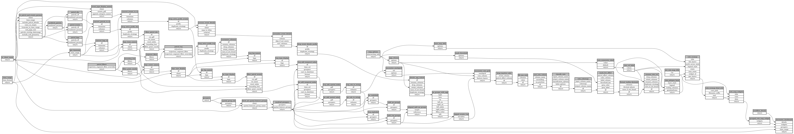

```
# AUTOGENERATED BY ECOSCOPE-WORKFLOWS; see fingerprint in README.md for details

```

```yaml
# fingerprint:
artifacts_sha256_basic: 726df5e6189d7ae7c99284a76c987573171bf57ee6ffb073401f504b3a0cda8b
artifacts_sha256_strict: efe9638263f7db57e0083b177b786279763f35a182119bc3d455d78ef9dbe581
installed_requirements:
- channel: https://repo.prefix.dev/ecoscope-workflows/
  name: ecoscope-platform
  version: {version: ==2.39.4}
- channel: conda-forge
  name: pydeck
  version: {version: ==0.9.2}
params_sha256: c198f244511bd1bacc0eee871ff98cb79adc865007c9e74e49f48ada139d91ed
spec_sha256: c8bb700f0a10f6e12b10fe033a1c401cb0afc947c6ef35568722a7a8656126f0

```

# ecoscope-workflows-patrol-encounter-rate-map-workflow


