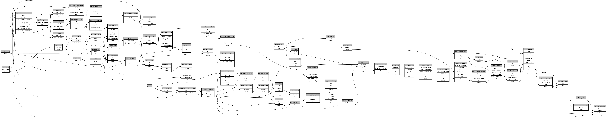

```
# AUTOGENERATED BY ECOSCOPE-WORKFLOWS; see fingerprint in README.md for details

```

```yaml
# fingerprint:
artifacts_sha256_basic: 99afdf53b37037a44d8e2d0612979d2d4a1249bf93129e9eabe542679b3e7779
artifacts_sha256_strict: 5e74852b46cb35d7a1d5b7b26c5a1624017767a918489cd1704b5b3a3367c612
installed_requirements:
- channel: https://repo.prefix.dev/ecoscope-workflows/
  name: ecoscope-platform
  version: {version: ==2.30.2}
- channel: conda-forge
  name: pydeck
  version: {version: ==0.9.2}
params_sha256: 4735507ae628a944d97b04db29ea9147aed6111802ccbd8a45e9a68f3e933ae4
spec_sha256: 4e0821ab060c18fcbb9c4b8fe00b1d2a0070d8117e3f9af388ef9820d3b12b6e

```

# ecoscope-workflows-patrol-encounter-rate-map-workflow


