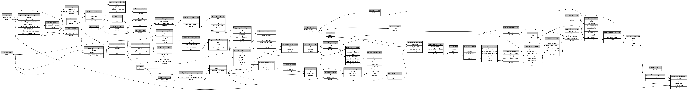

```
# AUTOGENERATED BY ECOSCOPE-WORKFLOWS; see fingerprint in README.md for details

```

```yaml
# fingerprint:
artifacts_sha256_basic: ef9aa4a3c48f2082c81c2bd285a547976c4bedc04c60d0764af9c6b394c1c2f2
artifacts_sha256_strict: 745ef550eadc587c63e02c84b890aeb2a42a03450ae537dc85dbe783b993eaa0
installed_requirements:
- channel: https://repo.prefix.dev/ecoscope-workflows/
  name: ecoscope-platform
  version: {version: ==2.27.1}
- channel: https://repo.prefix.dev/ecoscope-workflows-custom/
  name: ecoscope-workflows-ext-custom
  version: {version: ==0.1.1}
- channel: conda-forge
  name: pydeck
  version: {version: ==0.9.2}
params_sha256: 4735507ae628a944d97b04db29ea9147aed6111802ccbd8a45e9a68f3e933ae4
spec_sha256: 2f7c938419d79b7384dcf50beb211547c25674f0a1083dc0ba78cff3360defba

```

# ecoscope-workflows-patrol-encounter-rate-map-workflow


